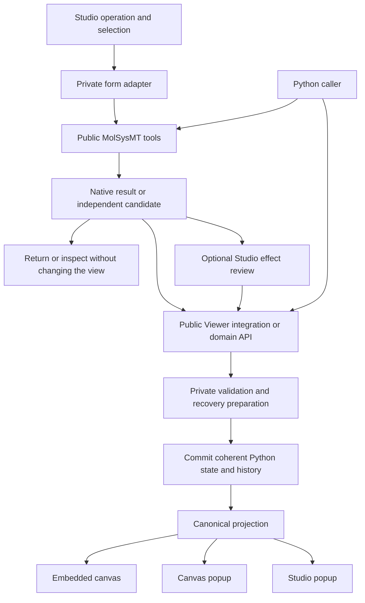

# Molecular operations and recovery — proposed technical design

**Status: proposed — revised 2026-10-22.** Apply the approved
[core/add-on boundary](core_and_addon_boundary.md). General molecular tools
belong to add-on/scientific interfaces; the earlier native-Studio placements
in this proposal require reassessment. Visual calculation conveniences retain
their scene owners. General automatic edit observation is no longer required.
This document develops the
[approved product direction](studio_molsysmt_integration_plan.md) using the
[169-export / 77-group inventory](studio_molsysmt_operation_inventory.md).
It is a design for review, not implemented behavior, a new public API or an
approved change to existing contracts. No runtime or provider qualification is
claimed. The inspected provider baseline remains the inventory's fixed source;
newer source and published packages need separate receiving.

## Product ambition expressed as design requirements

MolSysViewer should combine accessible exploration, scientific power, a strong
Python API and a calm interface. Achieving one must not undermine the others.
General operations, explicit selections and method-specific parameters form the
capability catalogue. Composed journeys validate completeness and composability;
they do not prescribe which scientific workflow a user should follow.

| Quality | Concrete design consequence | How to review it |
| --- | --- | --- |
| Easy to discover | Clear operation verbs, stable domain panels, reusable selection inputs and one canonical editor with contextual links. | A scientist can find atom removal and choose water, any ion or another population without needing a dedicated recipe or selection syntax. |
| Powerful and versatile | Preserve Python selectors, units, engines, return types and composition; offer relevant scientific controls in Studio. | Reproduce each workflow headlessly and exercise advanced Python arguments beyond the simplified form. |
| Calm | Short ordinary forms, persistent drafts, clear targets and restrained feedback; disclose specialist options when needed. | Narrow/wide cards and both popups preserve context, focus and camera; a background update does not reset the user's editor. |
| Scientifically explicit | Keep scope, units, method and evidence visible where they change interpretation. | Distinguish observed/inferred/unknown, current/all structures, chemical states, geometric contacts and assigned covalent bonds. |
| Safe to explore | Recoverable changes, truthful progress and clear failure boundaries. | Interleave edits, calculations and representations; Undo/Redo and failed preparation preserve coherent work. |
| Efficient | Reuse unchanged data and existing scientific owners; separate data processing from display budgets. | Measure combined molecule/results/history residency; a scene color change does not copy a trajectory. |
| Reproducible | Retain scientific inputs, actual method/provider provenance and portable results/work. | Save/reopen on a fresh process without silently rerunning or inventing missing provenance. |

Keep choices that affect scientific meaning in the ordinary task flow. Reduced
visual density must not hide a frame scope, an alignment definition or a loss
of chemical information. Technical execution tuning can use advanced controls.
Presets need explicit definitions and never silently change Python defaults.
Keyboard/focus behavior and access to context-menu tools remain requirements.
Copy Python from Studio remains separately deferred under uibcdf/molsysviewer#226.

## Reuse the owners already present

The [engineering rules](engineering_rules.md),
[scene contracts](scene_contracts.md),
[transport ownership](transport_state_ownership.md) and
[popup contract](canvas_popup_contract.md) remain normative. Extend these owners
when the design is approved; do not build an independent Studio state machine,
scientific implementation or generic workflow language alongside them.

| Responsibility | Owner / proposed extension |
| --- | --- |
| Selection, geometry, chemistry, scientific calculation and molecular editing | Public MolSysMT tools and their domain objects. |
| Apply scientific outputs to a view through public integration/domain operations | Existing `view.apply_system_edit`, extraction/load/result APIs and independently useful general extensions where required; preserve headless composition. |
| Translate a form and coordinate reusable internal steps | Private Python Studio adapters over public scientific/integration APIs; private reconciliation, history and transport services stay in their existing owners. |
| Coordinate supported changes of the linked MolSys | Explicit qualified reconciliation or coordination inside an integrated tool; uibcdf/molsysmt#413 discusses the provider boundary. Independent-result adoption remains explicit. |
| Canonical scene and scientific references | Existing Python managers and molecular domains; add only the owner required for a new persistent result type. |
| Ordered Undo/Redo | Extend the single Python history owner with recoverable molecular/result references as well as scene records. |
| Retained data and temporary backing | One history/revision storage owner with explicit references, budgets and cleanup; no complete trajectory copy per scene step. |
| Transport generations, request delivery and reconnect | Existing transfer/router owners; no parallel per-popup scientific session. |
| Rendering and editor presentation | Existing Mol*/TypeScript managers and Studio panels; drafts/layout stay window-local. |

The model is one current molecular system and one work history. Old molecular
revisions are recovery data, not extra visible systems or a new scene tree.

## Operation contracts before public method names

Each general operation needs an explicit contract describing its public Python
entry/composition, inputs and scientific return value, read/calculate/edit
effects, dependency scope, validated units and engine, resulting maps/results,
recovery policy and persistence route. Classify external side effects too.
An internal description may coordinate these facts; do not make callers wrap
existing arguments/results in a universal public request/response schema.

Inventory rows group related tools and use cases; their identifiers are not a
list of new public methods or canned workflows. Verify that the same operation
and resolved arguments produce the same scientific effects from categories,
saved selections, atom indices, expressions and shortcuts wherever admitted.
Provider methods lacking a selector retain their actual input contract.

Presentation fields such as active tab or confirmation wording do not belong
in scientific signatures. Programmatic callers supply explicit arguments;
Studio provides target review over those arguments. Core validation applies to
both, including invariants that cannot be bypassed by skipping digestion.

### Proposed Python recovery policy

Make the required recoverable integration available through general public
Viewer boundaries and existing history/domain owners. Python users can call
MolSysMT and apply its outputs through those boundaries; Studio privately
composes the same public tools. A general view-aware remove/transform tool may
be justified by independently useful integration semantics, assessed per tool.
There is no blanket requirement for a public wrapper per form, shortcut or
composed journey. Recording/storage controls remain explicit and usable in
batch work without a browser or confirmation. Both paths use the same owners.

The revised [edit/reconciliation direction](linked_molecular_edits_design.md)
uses explicit reconciliation or coordinated integrated-tool operations.
Receive public edit/outcome/correspondence contracts and preserve pre-edit
retention where managed recovery is promised. Do not monkey-patch every `msm`
call, poll whole trajectories or claim arbitrary raw writes are observed.
Independent returned systems still need explicit
adoption. Preserve existing low-level APIs and explicit recording policy.
An announced edit outside recorded history needs an explicit history boundary,
not a plausible but false Undo path. Unannounced raw changes remain outside
the managed validity contract. Document this boundary without weakening the
user's existing ability to use MolSysMT directly.

Recoverable loading changes the current scene-only history contract and needs
a deliberate migration even if signatures/returns remain unchanged. Additive
rebuilds and successful replacement clear history; uibcdf/molsysviewer#262 now
guards the replacement boundary. That fix is separate from retaining molecular
revisions for Undo. Review both compatibility and resource costs explicitly.

## Proposed operation lifecycle

This diagram shows preparation/adoption of an independent candidate or result.
Supported linked in-place edits additionally require the pre-edit coordination
and qualified reconciliation in the linked-edit design; a post-edit callback
alone cannot provide prior-state recovery. Current source implements neither
that general subscription nor complete molecular transactions.

The optional review is a presentation step over resolved inputs/output. A
shortcut supplies visible arguments to the same operation. Public compositions
and independently useful view-aware tools reach the same commit owner once;
none is required to construct Studio or package inputs in a GUI request object.

1. **Validate inputs and capture dependencies.** Resolve explicit atoms,
   structures/states, references and parameters against the current scientific
   input. Record the execution generation and check recovery resource needs.
2. **Prepare independently.** Run public provider tools on qualified independent
   input or staging data. No in-place provider default may mutate the committed
   live source during preparation. Retain actual method/provenance and output.
3. **Validate the candidate and its effects.** Verify axes, units, state links,
   maps, affected results and scene reconciliation. Prepare the recoverable
   outcome and required history storage before accepting the operation.
4. **Review in Studio where needed.** Present the explicit target/effects;
   uncertain estimates must be labeled. Expensive preparation need not run
   twice: retain a validated candidate and recheck its applicability at Apply.
   Python does not require this interactive review step.
5. **Commit in Python.** Recheck dependencies and serialize state-changing
   commits. Install coherent molecular/result/scene state and its history entry
   as one accepted operation. Failed preparation or commit retains the previous
   usable state and Redo path; semantic no-ops add no meaningful history step.
6. **Publish the committed projection.** Update endpoints through existing
   transfer generations. Acknowledge operation identity and commit outcome
   separately from each endpoint's display/synchronization state.

This is a proposed lifecycle, not a promise that every operation needs the same
costly machinery. Read-only inspection, scene-only changes, scientific-result
attachment and topology replacement have different dependencies and storage.
Keep existing lightweight scene operations lightweight.

### Failure after scientific commit

A disconnected popup does not invalidate a successful molecular calculation.
Distinguish **not committed**, **committed, display synchronization pending** and
**synchronized** where applicable. A committed operation must not be reported as
failed merely because one endpoint timed out, or repeated by a retry of the
same request. Resynchronize that endpoint from canonical state. An explicit
Undo remains available for the committed edit.

This refines the approved failure-recovery requirement: preserve prior work
on preparation/commit failure, and retain recoverability plus truthful status
after a successful commit with transport failure. It does not promise an atomic
transaction across Python and every browser window. Review error/return
compatibility before introducing this distinction to an existing Python method.

### Background work and concurrent interaction

Capture stable scientific input for long work; allow unrelated reading,
navigation and safe scene edits to continue where execution capabilities permit.
Do not invalidate a geometry calculation merely because a region changed color.
Use dependencies specific enough to distinguish molecular/state changes from
editor and appearance changes. Begin conservatively where validity cannot be
proven; never automatically rebase a scientific edit onto another atom domain.

Only qualified engines/execution routes may run concurrently. A pending label
does not prove that Python or the GUI remains responsive. Progress, interrupt
support, result discard and process termination are distinct capabilities.
Label an action that only discards a result accordingly; do not say an engine
stopped when it continues. Define retained candidate lifetime and disposal when
an editor closes, a request becomes obsolete or the viewer is closed.

Changing a molecular input or restoring old content creates a fresh execution
generation. Recovery never resurrects old requests, authorization tokens or
work that was pending when a saved state was captured. This extends existing
Interactions stale-result protections to the managed operations that need them.

## Recovery representation and storage

Represent an ordered work step with its label, coherent before/after scene
records, references to molecular/result versions and the relevant operation
metadata. Scientific buffers are stored once per retained version where safe,
not embedded in every scene JSON snapshot. Composite user operations form one
step; both outcomes are retained so Redo restores rather than reruns.

The runtime execution generation is separate from content identity and original
scientific provenance. Undo can restore the same scientific content while
advancing the runtime generation. Source maps and logical object identity must
survive restoration, but stale Python scene handles must not silently acquire
authority over new objects with the same tag. Preserve current manager-based
reacquisition checks; qualify old molecular/analysis handles separately.

Current provider source at the inventory baseline exposes `MolSys.copy(deep=…)`
with independent ownership and deferred protected geometry in its documented
contract. That is more recent source evidence than the analysis-only checkpoint
in the local [#259 receiving record](pending_proposals/native_copy_contract_receiving.md).
It is not a new published dependency floor or consumer qualification. Review
and receive the complete contract before selecting it for revision storage;
inspect raw aliases, non-coordinate domains and failed edits as well as nominal
copy success. Provider uibcdf/molsysmt#121 is now closed; Viewer #259 remains
open for this consumer receiving. No private provider copy internals become
Viewer dependencies.

Prefer bounded RAM storage with optional/eligible temporary disk backing;
select actual budgets and spill policy from combined measurements. Reserve
recovery capacity before destructive commit. Eviction keeps a continuous
reachable history and releases only unreferenced internal data. External Python
references may keep older objects alive beyond the history budget; do not
describe internal accounting as a process-RSS ceiling.

History storage must retain every domain it claims to recover. H5MSM 0.5 is
useful for supported molecular states/results, but cannot be a silent fallback
that drops nonempty mechanics or arbitrary new result types. Each eligible
storage route needs its own lossless receiving. Checkpoints protect selected
durable work milestones; ordinary history is session-scoped and has no implicit
crash-recovery promise. Reuse the
[temporary-resource lifecycle](temporary_resource_lifecycle.md).

## Results, validity and persistence

Keep native scientific results in their scientific owner, including named
Interactions in the MolSys. New RMSD/SASA/graph/correspondence results retain
their native return contracts; Viewer may associate a detached record of source,
scope, units, method and applicability for display/history/save. Avoid a
universal analysis database or compulsory wrapper for all public results.

Define validity by actual dependencies: graph/state/atom-domain changes can
invalidate chemistry-only maps, while coordinate edits affect geometry-derived
results. Preserve old evidence as history where supported without projecting it
onto incompatible current atoms. A saved result and its original producer stay
the same on Undo/Redo; restoring does not credit a calculation as newly executed.

Every new persistent result needs a display, recovery and save/checkpoint
contract before its workflow is called complete. Coherent file capture uses
one retained revision while later work may continue; destination atomicity and
input consistency require separate checks.

## External files and irreversible side effects

Ordinary work history restores the session; it does not delete downloaded files
or reverse arbitrary external file writes. A saved output remains a saved
output after Undo. Downloads, overwrites and H5MSM external append need explicit
operation classifications and truthful feedback.

Prefer creating a new output file or using a qualified atomic replacement path.
Direct external-file modification requires its own preflight, overwrite/backup
policy and failure checks. Do not claim filesystem Undo without actually
retaining and safely restoring the old file. Python path arguments and existing
writer capabilities remain intact; Studio may guide the safe ordinary route.
Caller files and durable checkpoints are never runtime-history cleanup targets.

## Proposed choices to review before implementation

| Choice | Alternatives / trade-off | Proposed direction |
| --- | --- | --- |
| Python integration and recovery | Add wrappers per journey, or compose scientific tools with general Viewer boundaries and explicit history policy. | Reuse public tools first; private adapters share those boundaries. Assess new general view-aware tools by added value and review changes individually. |
| Molecular setters and synchronization | Explicit reconciliation or coordinated operations through the proposed tools add-on. | Scientific assignment stays in MolSysMT. Keep current setters until any replacement is implemented/qualified; design deferred-update safety and retain explicit adoption/direct-write limits. |
| History storage | Full copies per step are simple but expensive; command inverses are compact but difficult to prove; qualified shared versions reduce copying. | Scene records plus retained molecular/result versions, with measured RAM/disk policy and selective proven deltas. |
| Background commits | Hold the live system locked for an entire calculation, or prepare against captured input and validate at a short commit boundary. | Independent preparation and serialized commits where supported; explicit stale-result rejection and execution capability limits. |
| Scientific result organization | One compulsory generic result model, or domain-native returns with explicit Viewer associations. | Preserve native Python returns and scientific owners; add only the common metadata/ownership the actual workflows need. |
| Transport failure | Roll back globally whenever a window fails, or retain committed science and resynchronize that window. | Separate commit outcome from display status; no repeated scientific execution on transport retry. |
| External file mutation | Pretend ordinary Undo covers files, retain explicit backups, or write a new output. | Prefer new output; qualify overwrite/append independently and never imply unimplemented filesystem recovery. |

These recommendations refine accepted goals. They need review before becoming
implementation contracts; method names, policy defaults/budgets, result storage
routes and provider receiving are not frozen by writing this proposal.

## Validate general tools through composed acceptance scenarios

The [six foundation operation/scenario specifications](studio_foundation_workflow_contracts.md) are
prepared for review against the inspected provider source. They preserve
existing Python calls and identify missing orchestration/receiving rather than
pretending new Viewer methods already exist.

Use six composed acceptance scenarios to exercise the architecture: 1TCD remove/retain/
save/recover; chemical inspection and hydrogen placement; correspondence and
coordinate alignment; box assignment and periodic editing; a property series
and its saved result; existing Interactions plus named result changes. Include
multiple sources, many structures, a shape-only start and independent windows.
These are foundation probes, not six prescribed user workflows or a cap on the
inventory's 1.0 scope. Include unrelated populations and selections beyond the
example systems so success does not depend on recognizing a recipe.

For each, describe the public Python operation/composition first, input and
output examples using existing types, exact scientific defaults, Studio target
review, invalidation, operation/recovery cost, failure cases and persistence.
The [interactive task prototype and review](studio_task_design_review.md)
now provide wide/narrow task forms and proposed resolutions of the choices.
Review them before implementation; the illustrative prototype does not execute
the scientific workflows or qualify actual popup synchronization. Validate that
scientific essentials remain visible. Name the necessary provider work and
bounded implementation issues only after those contracts are reviewable.

Acceptance should include stale target/result rejection, failed commit,
committed-but-disconnected display, repeated requests, Undo/Redo without engines
or original input files, navigation preservation, history eviction/disk failure,
old-handle behavior and Python headless parity. Measure scale using small real
systems, multi-source 1TCD work and trajectory/sparse-analysis workloads; record
actual atoms, structures, occurrence counts, bytes and environment rather than
claiming arbitrary-scale support.

Implementation starts after review of the proposed choices and workflow
compositions and general operation contracts. Keep scientific correctness, usability evidence, source CI and exact
installed qualification distinct. No broad rewrite of current managers is
justified merely by this plan, and no publication is authorized.

## When planning is sufficiently consolidated

Before implementation, confirm these concrete deliverables:

1. Reviewed general-tool/public-integration/private-adapter boundaries, Python
   recording policy, transaction boundaries,
   result ownership, revision storage and external side effects.
2. General operation contracts and six composed acceptance scenarios, with public Python inputs/returns,
   scope/defaults, recovery and failure behavior; reusable contract profiles for
   the remaining inventory rows and explicit exceptions where they differ.
3. Wide/narrow Studio mockups demonstrating discoverable tasks, essential
   scientific choices and preserved context, alongside full Python capability.
4. Provider/engine/writer prerequisites tied to exact inspected sources and
   published availability, with named receiving work and no inferred support.
5. A scoped implementation order with owning issues, contract migrations,
   compatibility checks, scale-measurement workloads and human acceptance cases.

Final packaging coordinates and installed qualification follow implementation;
they are not prerequisites for discussing the design. The plan is ready to
implement when these choices are reviewed, not merely when its document stops
changing or its list of functions is long enough.
